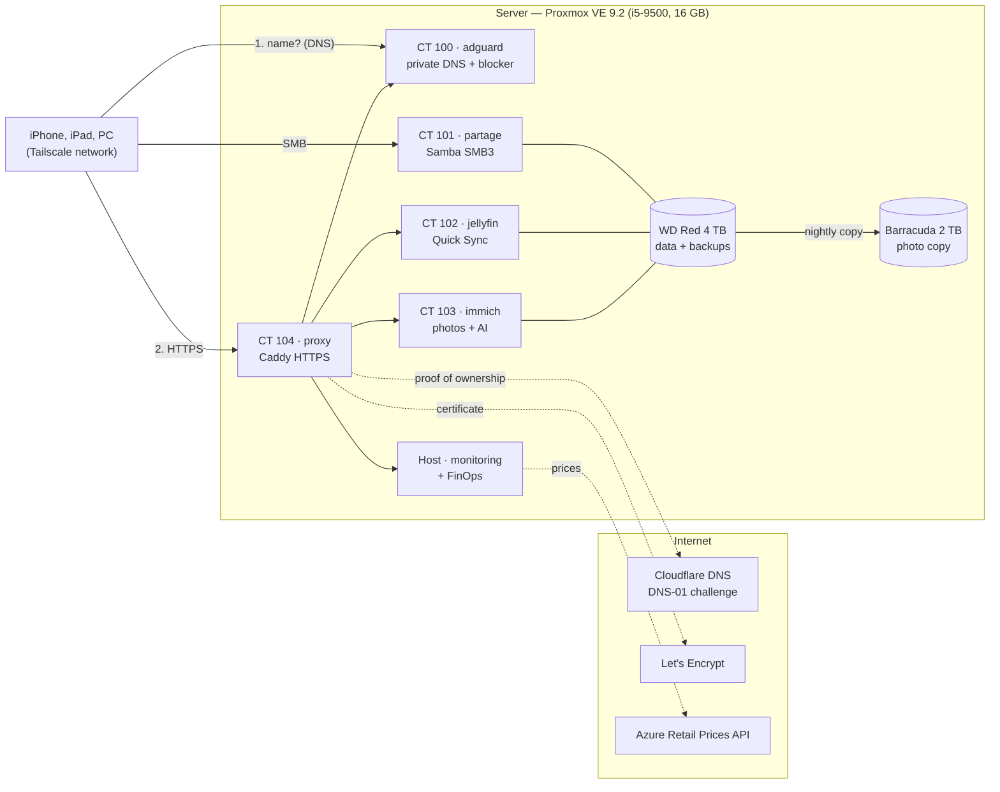

# Home Cloud — a miniature enterprise cloud on an old PC

An old desktop PC turned into a **small personal data center**, built the way a company's infrastructure would be: hypervisor, services isolated in containers, zero-trust remote access, private DNS, automatic HTTPS, backups, monitoring and **cost management (FinOps)**.

Personal project built in October 2026 by **Antoine**, 4th-year engineering student at ESIEA (Laval, France), to learn hands-on how the cloud works.


> **TL;DR —** A repurposed desktop PC running Proxmox VE and five unprivileged LXC containers (SMB file share, Jellyfin with Intel Quick Sync, Immich, AdGuard Home DNS, Caddy reverse proxy). Remote access is zero-trust over Tailscale with **no open ports**, internal names resolve through a private DNS zone, and HTTPS uses a Let's Encrypt wildcard certificate obtained via the DNS-01 challenge. Nightly snapshots, a soft-delete photo copy, SMART monitoring, a custom kiosk dashboard, and a **FinOps showback page** that measures real CPU energy (Intel RAPL), allocates cost per service and compares the total cost of ownership with live Azure retail prices (~13 €/month at home vs ~260 €/month on Azure pay-as-you-go). Every component is mapped to its Azure equivalent below.

---

## Architecture



**Principle:** no port is open on the ISP router. Everything goes through the encrypted **Tailscale** private network (WireGuard). AdGuard answers queries for `*.maison.<domain>` with the proxy's address; these names do not exist in public DNS. (Internal names are in French: `maison` means "home", and `tableau` in `tableau.maison.<domain>` means "dashboard".)

| Container | Role | Resources | Key points |
|---|---|---|---|
| **100 · adguard** | DNS for Tailscale devices, ad and tracker blocking, private DNS zone | 1 core, 512 MB | Encrypted upstream DNS (DoH), `*.maison.<domain>` rewrite |
| **101 · partage** (share) | File sharing for photos and movies (PC, iPhone) | 1 core, 512 MB | SMB3 minimum, no guest access, NetBIOS disabled, `fruit` module for iOS |
| **102 · jellyfin** | Movie streaming (Streamyfin on iPhone, including over 5G) | 4 cores, 3 GB | Intel Quick Sync hardware transcoding, movies mounted **read-only** |
| **103 · immich** | Photo gallery with content-based search (multilingual model) | 4 cores, 7 GB | Docker inside an unprivileged LXC, photos **read-only** |
| **104 · proxy** | Single HTTPS entry point | 1 core, 512 MB | Caddy, Let's Encrypt wildcard certificate via DNS challenge |
| **Host** | Monitoring, HDMI screen, backups, FinOps, photo sorting, PC wake-up | — | Dependency-free Python collector, systemd timers |

---

## What each component represents in the cloud (Azure)

| Home Cloud component | Azure equivalent | Concept illustrated |
|---|---|---|
| Proxmox VE + LXC containers | Virtual Machines, Azure Container Instances / AKS | Virtualization, isolation, sharing a single host |
| **Unprivileged** containers, read-only mounts | RBAC roles, least-privilege identities | Least privilege |
| WD Red (data) + `sauvegardes` (backups) storage | Managed Disks, Azure Files | Separating system, data and backups |
| Nightly `vzdump` snapshots (7 days + 4 weeks) | Azure Backup, Recovery Services vault | Retention, RPO / RTO |
| `rsync` copy with 90-day recycle bin | Blob Storage soft delete | Protection against human error |
| Tailscale (WireGuard), no open ports | VPN Gateway, Azure Bastion, private endpoints | Zero trust, no public exposure |
| AdGuard: DNS rewrites | Azure Private DNS zones, DNS Private Resolver | Private DNS (split-horizon) |
| Caddy, single reverse proxy | Application Gateway / Front Door | Single entry point, TLS termination |
| Let's Encrypt via DNS-01 challenge | Managed certificates, Key Vault | Automatic renewal with no inbound port |
| Cloudflare token scoped to one zone, read-only Proxmox token | Managed identity + restricted role | Least privilege applied to APIs |
| `.env` files with mode `640`, never committed | Azure Key Vault | Secrets management |
| Collector + monitoring screen + SMART readings | Azure Monitor, Workbooks | Observability |
| FinOps page: measured energy, cost per service, comparison | Cost Management, tags, showback | FinOps: visibility, cost allocation, total cost |

---

## FinOps: how much does this server really cost?

The dashboard's `/finops` page answers three questions:

1. **How much power does it draw?** CPU energy is **measured** every minute using its built-in counters (Intel RAPL). The rest of the PC (disks, motherboard) is estimated, then the power supply efficiency is applied.
2. **Who consumes what?** Every minute is **allocated to services** (*showback*):
   - the **variable share** (CPU above idle) in proportion to the CPU time actually used by each container;
   - the **fixed share** (idle, disks, motherboard) in proportion to reserved memory, like reserved capacity in the cloud.
3. **What would it cost on Azure?** Public prices are fetched every week through the Azure Retail Prices API (no account needed), for a B4ms VM and a 4 TB disk in France Central.

**First results (October 2026):**

| | Per month |
|---|---|
| Electricity (≈ 22 W at the wall, 0.2001 €/kWh) | ≈ 3.2 € |
| Hardware bought for the project, amortized over 36 months | 9.55 € |
| **Home Cloud total** | **≈ 13 €** |
| Azure B4ms VM (Linux, pay-as-you-go) | 121.40 € |
| Standard HDD S50 disk (4 TB) | 138.75 € |
| **Equivalent Azure total** | **≈ 260 €** |

The cloud is not "too expensive" per se: this is a **steady, 24/7, storage-heavy** workload, the worst case for pay-as-you-go pricing. On Azure, the levers would be a 1- or 3-year reservation, cool Blob storage for the photos, and shutting the VM down at night. In return, Azure would provide what the home server lacks: high availability, an off-site copy, and no hardware failures to deal with.

Full method and assumptions: [docs/11-finops.md](docs/11-finops.md).

---

## Repository contents

```
docs/          one page per step, with the choices made and why
scripts/       installation scripts, numbered in build order
services/      scripts run by systemd (copy, SMART, photo sorting, FinOps) + units
supervision/   Python collector and dashboard pages (screen + FinOps)
configs/       sanitized real configurations and .example templates for secrets
screenshots/   photos and screenshots
```

| Step | Documentation | Script |
|---|---|---|
| 1. Hardware and Proxmox | [01-hardware-and-proxmox.md](docs/01-hardware-and-proxmox.md) | — |
| 2. Disks, storage and backups | [02-storage-and-backups.md](docs/02-storage-and-backups.md) | `01-prepare-disks.sh` |
| 3. SMB file share | [03-smb-file-share.md](docs/03-smb-file-share.md) | `02-create-share.sh` |
| 4. Tailscale remote access | [04-remote-access-tailscale.md](docs/04-remote-access-tailscale.md) | `03-tailscale-share.sh` |
| 5. Jellyfin and Quick Sync | [05-jellyfin.md](docs/05-jellyfin.md) | `04-create-jellyfin.sh` |
| 6. Monitoring and screen | [06-monitoring-dashboard.md](docs/06-monitoring-dashboard.md) | `05-install-dashboard.sh`, `06-install-display.sh` |
| 7. Automatic photo sorting | [07-photo-sorter.md](docs/07-photo-sorter.md) | `07-install-photo-sorter.sh` |
| 8. Immich | [08-immich.md](docs/08-immich.md) | `08-create-immich.sh` |
| 9. Private DNS and blocker | [09-dns-adguard.md](docs/09-dns-adguard.md) | `09-create-adguard.sh` |
| 10. HTTPS reverse proxy | [10-https-reverse-proxy.md](docs/10-https-reverse-proxy.md) | `10-create-proxy.sh` |
| 11. FinOps | [11-finops.md](docs/11-finops.md) | `11-install-finops.sh`, `12-add-dashboard-toggle.sh` |
| Quick links page | [06-monitoring-dashboard.md](docs/06-monitoring-dashboard.md) | `13-add-links-page.sh` |
| Personal "papiers" (documents) folder | [03-smb-file-share.md](docs/03-smb-file-share.md) | `14-add-papers-share.sh` |
| Turn the PC on remotely (Wake-on-LAN) | [06-monitoring-dashboard.md](docs/06-monitoring-dashboard.md) | `15-add-wake-on-lan.sh` |
| Security | [security.md](docs/security.md) | `export-home-cloud.sh` |
| Issues encountered | [lessons-learned.md](docs/lessons-learned.md) | — |

The scripts are written for **this** installation (Proxmox VE 9, Debian 13, `192.168.1.0/24` network) and run as root on the host. They check their prerequisites, prompt for passwords with hidden input, and stop at the slightest doubt rather than break something.

## Repository security

No secrets are committed. Passwords, the Jellyfin API key, the Proxmox token and the Cloudflare token live only in protected files on the server; the repository contains only `.example` templates. Disk serial numbers, MAC addresses, Tailscale addresses and the domain name have been replaced with placeholder values.

## Known limitations

- **No off-site copy**: both disks are in the same machine (3-2-1 rule not fully met). A fire or theft would take everything.
- **Single server**: no high availability; a hardware failure takes down every service.
- **Non-CPU power draw is estimated** (14 W): to be confirmed with a plug-in power meter.

## Skills applied

Virtualization (Proxmox VE, LXC) · Linux (Debian, systemd, ext4, fstab, permissions and UID mapping) · Networking (DHCP, DNS, WireGuard/Tailscale, SMB3) · Security (zero trust, least privilege, secrets management) · TLS and certificates (ACME, DNS-01 challenge) · Storage and backup (snapshots, retention, soft delete, SMART) · Monitoring (Proxmox and Jellyfin APIs, `/proc`, sensors) · Automation (Bash, Python) · FinOps (measurement, cost allocation, total cost of ownership, Azure pricing API).

## License

Code released under the MIT License (see [LICENSE](LICENSE)).
