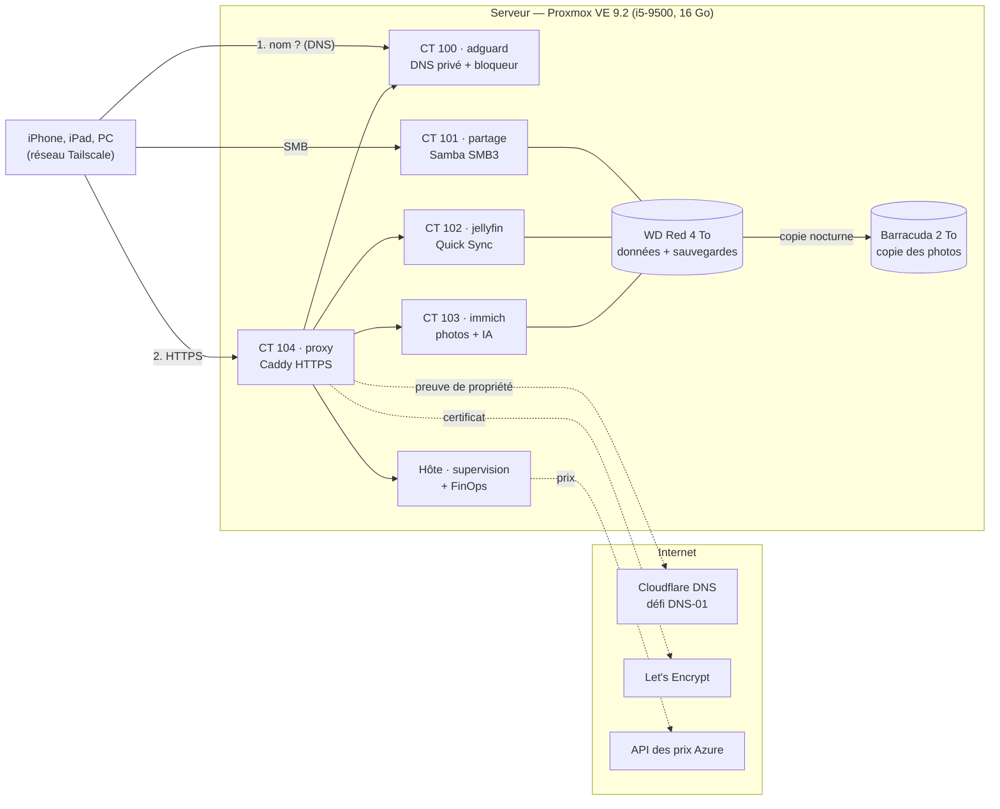

# Home Cloud — un cloud d'entreprise en miniature sur un vieux PC

Un ancien PC de bureau transformé en **petit centre de données personnel**, construit comme le serait l'infrastructure d'une entreprise : hyperviseur, services isolés en conteneurs, accès distant « zéro confiance », DNS privé, HTTPS automatique, sauvegardes, supervision et **pilotage des coûts (FinOps)**.

Projet personnel réalisé en octobre 2026 par **Antoine**, étudiant ingénieur en 4ᵉ année à l'ESIEA (Laval), pour apprendre concrètement le fonctionnement du cloud.


> **In English —** A repurposed desktop PC running Proxmox VE and five unprivileged LXC containers (SMB file share, Jellyfin with Intel Quick Sync, Immich, AdGuard Home DNS, Caddy reverse proxy). Remote access is zero‑trust over Tailscale with **no open ports**, internal names resolve through a private DNS zone, and HTTPS uses a Let's Encrypt wildcard certificate obtained by DNS‑01 challenge. Nightly snapshots, a soft‑delete photo copy, SMART monitoring, a custom kiosk dashboard, and a **FinOps showback page** that measures real CPU energy (Intel RAPL), allocates cost per service and compares the total cost of ownership with live Azure retail prices (~13 €/month at home vs ~260 €/month on Azure pay‑as‑you‑go). Every component is mapped to its Azure equivalent below.

---

## Architecture



**Principe :** aucun port n'est ouvert sur la box. Tout passe par le réseau privé chiffré **Tailscale** (WireGuard). AdGuard répond aux noms `*.maison.<domaine>` par l'adresse du proxy ; ces noms n'existent pas dans le DNS public.

| Conteneur | Rôle | Ressources | Points clés |
|---|---|---|---|
| **100 · adguard** | DNS des appareils Tailscale, blocage pub et pisteurs, zone DNS privée | 1 cœur, 512 Mo | DNS amont chiffré (DoH), réécriture `*.maison.<domaine>` |
| **101 · partage** | Partage de fichiers photos et films (PC, iPhone) | 1 cœur, 512 Mo | SMB3 minimum, pas d'invité, NetBIOS coupé, module `fruit` pour iOS |
| **102 · jellyfin** | Streaming des films (Streamyfin sur iPhone, y compris en 5G) | 4 cœurs, 3 Go | Transcodage matériel Intel Quick Sync, films montés **en lecture seule** |
| **103 · immich** | Galerie photos avec recherche par contenu (modèle multilingue) | 4 cœurs, 7 Go | Docker dans un LXC non privilégié, photos **en lecture seule** |
| **104 · proxy** | Porte d'entrée HTTPS unique | 1 cœur, 512 Mo | Caddy, certificat générique Let's Encrypt par défi DNS |
| **Hôte** | Supervision, écran HDMI, sauvegardes, FinOps, tri des photos | — | Collecteur Python sans dépendance, minuteurs systemd |

---

## Ce que chaque brique représente dans le cloud (Azure)

| Brique du Home Cloud | Équivalent Azure | Notion illustrée |
|---|---|---|
| Proxmox VE + conteneurs LXC | Machines virtuelles, Azure Container Instances / AKS | Virtualisation, isolation, mutualisation d'un hôte |
| Conteneurs **non privilégiés**, montages en lecture seule | Rôles RBAC, identités à privilèges minimaux | Moindre privilège |
| WD Red (données) + stockage `sauvegardes` | Managed Disks, Azure Files | Séparer système, données et sauvegardes |
| Instantanés `vzdump` nocturnes (7 jours + 4 semaines) | Azure Backup, coffre Recovery Services | Rétention, RPO / RTO |
| Copie `rsync` avec corbeille 90 jours | Suppression réversible (soft delete) du stockage Blob | Protection contre l'erreur humaine |
| Tailscale (WireGuard), aucun port ouvert | VPN Gateway, Azure Bastion, points de terminaison privés | Zéro confiance, pas d'exposition publique |
| AdGuard : réécritures DNS | Zones Azure Private DNS, DNS Private Resolver | DNS privé (split-horizon) |
| Caddy, proxy inverse unique | Application Gateway / Front Door | Point d'entrée unique, terminaison TLS |
| Let's Encrypt par défi DNS-01 | Certificats gérés, Key Vault | Renouvellement automatique sans port entrant |
| Jeton Cloudflare limité à une zone, jeton Proxmox en lecture seule | Identité managée + rôle restreint | Moindre privilège appliqué aux API |
| Fichiers `.env` en `640`, jamais versionnés | Azure Key Vault | Gestion des secrets |
| Collecteur + écran de supervision + relevés SMART | Azure Monitor, classeurs (Workbooks) | Observabilité |
| Page FinOps : énergie mesurée, coût par service, comparaison | Cost Management, étiquettes, showback | FinOps : visibilité, imputation, coût total |

---

## FinOps : combien coûte vraiment ce serveur ?

La page `/finops` du tableau de bord répond à trois questions :

1. **Combien ça consomme ?** L'énergie du processeur est **mesurée** chaque minute grâce à ses compteurs intégrés (Intel RAPL). Le reste du PC (disques, carte mère) est estimé, puis on applique le rendement de l'alimentation.
2. **Qui consomme quoi ?** Chaque minute est **imputée aux services** (*showback*) :
   - la **part variable** (processeur au-dessus du repos) au prorata du temps processeur réellement consommé par chaque conteneur ;
   - la **part fixe** (repos, disques, carte mère) au prorata de la mémoire réservée, comme une capacité réservée dans le cloud.
3. **Et sur Azure ?** Les prix publics sont relevés chaque semaine via l'API des prix de détail Azure (sans compte), pour une VM B4ms et un disque de 4 To en France Centre.

**Premiers résultats (octobre 2026) :**

| | Par mois |
|---|---|
| Électricité (≈ 22 W à la prise, 0,2001 €/kWh) | ≈ 3,2 € |
| Matériel acheté pour le projet, amorti sur 36 mois | 9,55 € |
| **Total Home Cloud** | **≈ 13 €** |
| VM Azure B4ms (Linux, à l'usage) | 121,40 € |
| Disque HDD standard S50 (4 To) | 138,75 € |
| **Total Azure équivalent** | **≈ 260 €** |

Le cloud n'est pas « trop cher » en soi : c'est un usage **stable, 24 h/24, avec beaucoup de stockage**, le pire cas pour un tarif à l'usage. Sur Azure, les leviers seraient une réservation sur 1 ou 3 ans, du stockage Blob froid pour les photos et l'arrêt de la VM la nuit. En échange, Azure apporterait ce que le serveur maison n'a pas : haute disponibilité, copie hors site, aucune panne matérielle à gérer.

Méthode complète et hypothèses : [docs/11-finops.md](docs/11-finops.md).

---

## Contenu du dépôt

```
docs/          une page par étape, avec les choix et leurs raisons
scripts/       scripts d'installation, numérotés dans l'ordre de construction
services/      scripts lancés par systemd (copie, SMART, tri des photos, FinOps) + unités
supervision/   collecteur Python et pages du tableau de bord (écran + FinOps)
configs/       configurations réelles nettoyées et modèles .exemple pour les secrets
captures/      photos et captures d'écran
```

| Étape | Documentation | Script |
|---|---|---|
| 1. Matériel et Proxmox | [01-materiel-et-proxmox.md](docs/01-materiel-et-proxmox.md) | — |
| 2. Disques, stockage et sauvegardes | [02-stockage-et-sauvegardes.md](docs/02-stockage-et-sauvegardes.md) | `01-preparer-disques.sh` |
| 3. Partage de fichiers SMB | [03-partage-smb.md](docs/03-partage-smb.md) | `02-creer-partage.sh` |
| 4. Accès distant Tailscale | [04-acces-distant-tailscale.md](docs/04-acces-distant-tailscale.md) | `03-tailscale-partage.sh` |
| 5. Jellyfin et Quick Sync | [05-jellyfin.md](docs/05-jellyfin.md) | `04-creer-jellyfin.sh` |
| 6. Supervision et écran | [06-supervision.md](docs/06-supervision.md) | `05-installer-ecran.sh`, `06-installer-affichage.sh` |
| 7. Tri automatique des photos | [07-tri-photos.md](docs/07-tri-photos.md) | `07-installer-tri-photos.sh` |
| 8. Immich | [08-immich.md](docs/08-immich.md) | `08-creer-immich.sh` |
| 9. DNS privé et bloqueur | [09-dns-adguard.md](docs/09-dns-adguard.md) | `09-creer-adguard.sh` |
| 10. Proxy inverse HTTPS | [10-proxy-https.md](docs/10-proxy-https.md) | `10-creer-proxy.sh` |
| 11. FinOps | [11-finops.md](docs/11-finops.md) | `11-installer-finops.sh`, `12-ajout-bascule.sh` |
| Sécurité | [securite.md](docs/securite.md) | `exporter-home-cloud.sh` |
| Problèmes rencontrés | [lecons-apprises.md](docs/lecons-apprises.md) | — |

Les scripts sont écrits pour **cette** installation (Proxmox VE 9, Debian 13, réseau `192.168.1.0/24`) et se lancent en root sur l'hôte. Ils vérifient leurs prérequis, demandent les mots de passe en saisie masquée et s'arrêtent au moindre doute plutôt que de casser quelque chose.

## Sécurité du dépôt

Aucun secret n'est versionné. Les mots de passe, la clé d'API Jellyfin, le jeton Proxmox et le jeton Cloudflare vivent uniquement dans des fichiers protégés sur le serveur ; le dépôt ne contient que des modèles `.exemple`. Les numéros de série des disques, les adresses MAC, les adresses Tailscale et le nom de domaine ont été remplacés par des valeurs d'exemple.

## Limites assumées

- **Pas de copie hors site** : les deux disques sont dans la même machine (règle 3-2-1 incomplète). Un incendie ou un vol emporterait tout.
- **Un seul serveur** : aucune haute disponibilité ; une panne matérielle coupe tous les services.
- **Consommation hors processeur estimée** (14 W) : à confirmer avec une prise wattmètre.

## Compétences mises en œuvre

Virtualisation (Proxmox VE, LXC) · Linux (Debian, systemd, ext4, fstab, droits et décalage d'UID) · Réseau (DHCP, DNS, WireGuard/Tailscale, SMB3) · Sécurité (zéro confiance, moindre privilège, gestion des secrets) · TLS et certificats (ACME, défi DNS-01) · Stockage et sauvegarde (instantanés, rétention, suppression réversible, SMART) · Supervision (API Proxmox et Jellyfin, `/proc`, capteurs) · Automatisation (Bash, Python) · FinOps (mesure, imputation, coût total de possession, API de prix Azure).

## Licence

Code publié sous licence MIT (voir [LICENSE](LICENSE)).
