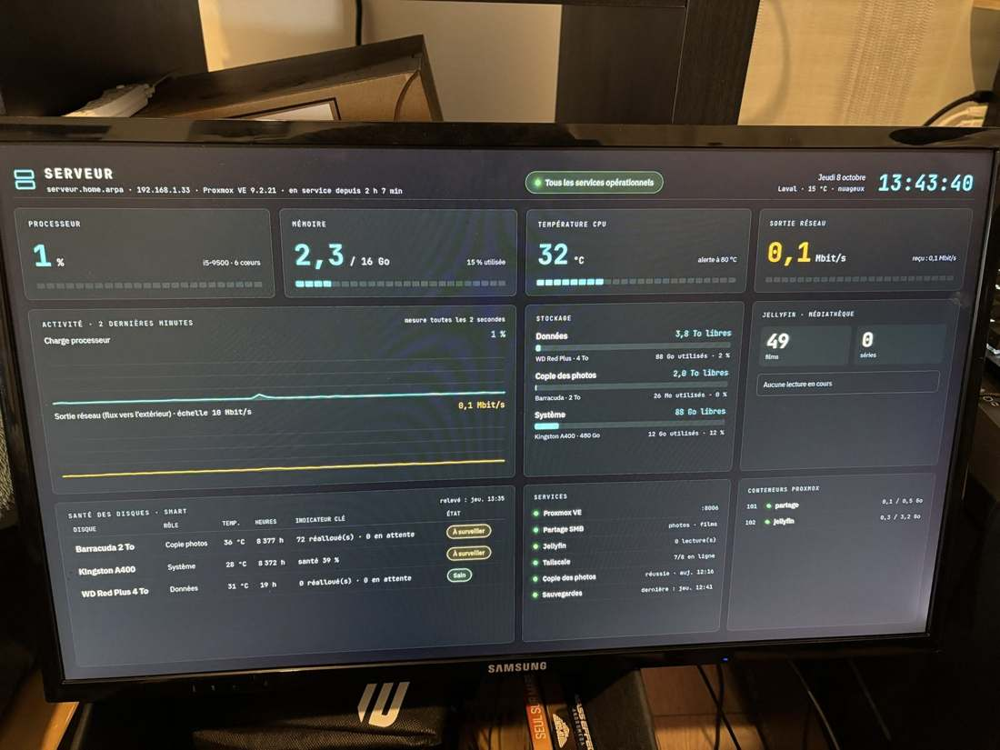

# 6. Monitoring and the server screen

Scripts: `scripts/05-install-dashboard.sh` (collector, page, SMART readings) and `scripts/06-install-display.sh` (HDMI display)
Code: `supervision/collecteur.py`, `supervision/index.html`



## Architecture

```
/proc, sensors, disks      ─┐
Proxmox API (read-only)     ┤
Jellyfin API                ├─► collecteur.py ──► /api/etat (JSON) ──► web page ──► HDMI screen (kiosk)
tailscale status            ┤    127.0.0.1:8088                                 └──► browser (via Tailscale)
SMART readings, copy,       ┘
backups, FinOps
```

### The collector — `collecteur.py`

A single Python file, **standard library only** (nothing to install, nothing to update). Two loops:

- **every second**: CPU load (`/proc/stat`), memory, temperature (`coretemp`), per-core frequency (`cpufreq`), network throughput;
- **every 15 seconds**: disk space, media library and active streams (Jellyfin API), containers (Proxmox API), Tailscale devices online, SMART health, copy and backup status, FinOps summary.

It only listens on `127.0.0.1`: nothing is exposed on the network.

### Least privilege for the APIs

- **Proxmox**: a dedicated `supervision@pve` user with a token that only has the **PVEAuditor** role (read-only). Even if stolen, this token cannot change anything.
- **Jellyfin**: a dedicated API key, sent with the modern `Authorization: MediaBrowser Token="…"` header.
- Both secrets are stored in `/etc/supervision.env`, mode `640 root:supervision`, read by a service running under an unprivileged account (`supervision`). Template: `configs/supervision.env.example`.

### The page — `index.html`

A page designed for a 1920 × 1080 screen and scaled automatically, in a "control room" style: key indicators, 2-minute graphs (load, frequency in GHz with the ceiling when the CPU is throttled, network output), storage, Jellyfin, SMART table, status of services and containers. A **COÛTS** ("costs") button switches to the [FinOps page](11-finops.md).

## Display on the HDMI screen — `06-install-display.sh`

No full desktop: **cage** (a "kiosk" Wayland compositor) launches **Chromium in full screen** on the page, on terminal `tty1`, at boot.

- dedicated `kiosque` account **with no password and no admin rights**;
- dedicated PAM session for the service; automatic restart on crash.

## Remote access

`tailscale serve --bg --http=80 8088` publishes the page on the server's Tailscale address, and only there; it is also reachable over HTTPS through the [proxy](10-https-reverse-proxy.md): `https://tableau.maison.<domain>`.

## Links page — `/liens`

A simple page that gathers every access point (services, administration, shared folders with a "Copier" ("copy") button), meant to be bookmarked: `https://tableau.maison.<domain>/liens`. Script: `scripts/13-add-links-page.sh`.

## Turning the PC on remotely (Wake-on-LAN)

Script: `scripts/15-add-wake-on-lan.sh`. The "Mon PC" section at the top of `/liens` shows whether the gaming PC is on and has an **Allumer** ("turn on") button.

- **How it works:** a powered-off PC keeps its Ethernet adapter listening. The collector sends a *magic packet* (6 bytes `FF`, then the PC's MAC address repeated 16 times) as a UDP broadcast on the LAN, ports 9 and 7. Because the server is inside the home network, the button also works from a phone over 5G: the phone talks to the server through Tailscale, and the server wakes the PC locally. No port is opened on the router.
- **Status:** `GET /api/pc` reads `tailscale status --json`; the PC counts as on once its Tailscale client is online (1 to 2 minutes after power-on).
- **Protection:** `POST /api/pc/reveil` requires an `X-Reveil: 1` header. A plain HTML form or link on another website cannot add a custom header, so it cannot trigger the wake-up behind the user's back (a simple CSRF defense). At most one packet burst every 10 seconds.
- **PC prerequisites:** Wake on LAN enabled in the BIOS with the "S5 maximum power savings" / ErP option disabled, "Wake on Magic Packet" enabled on the Ethernet adapter, and Windows Fast Startup disabled (otherwise "Shut down" is a hybrid hibernation that often leaves the adapter unarmed).
- **Cloud equivalent:** the "Start" button of an Azure VM (deallocated VMs cost nothing in compute, the basis of "shut down at night" FinOps savings).

## SMART readings — `services/releve-smart.py`

Every 10 minutes: temperature, power-on hours, reallocated or pending sectors for the hard drives, and data written relative to rated endurance for the SSD. The "À surveiller" ("watch") and "Critique" ("critical") thresholds are computed and shown on the screen.

## Cloud equivalent

Azure Monitor (metrics and logs), Azure Workbooks (dashboards), read-only identities for data collection.
